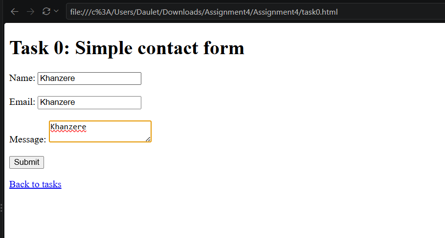
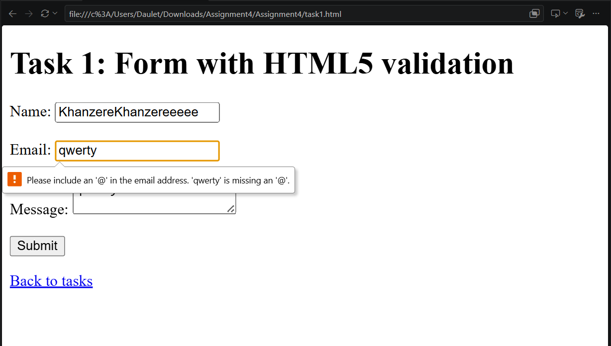
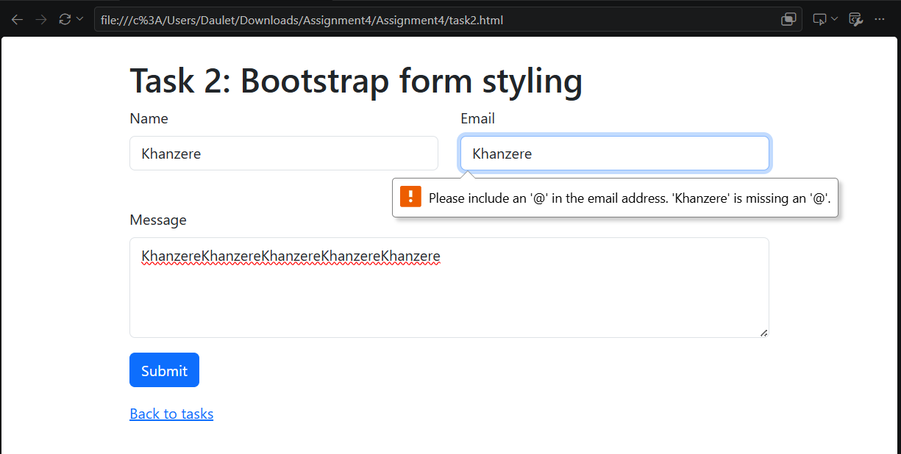
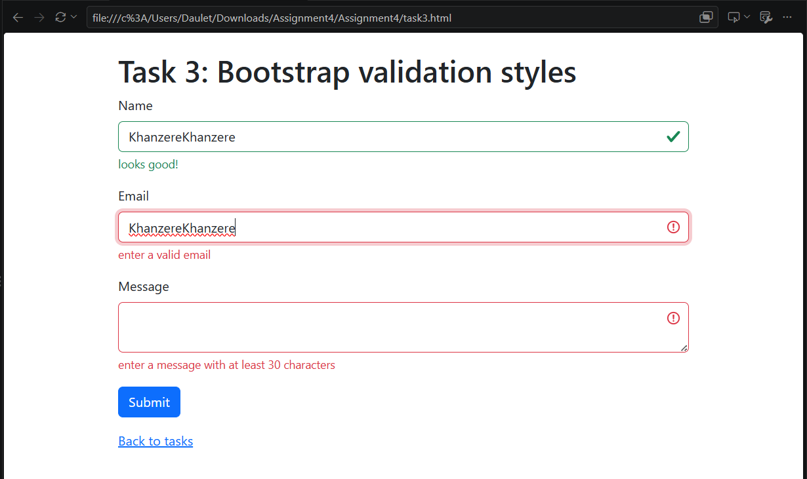
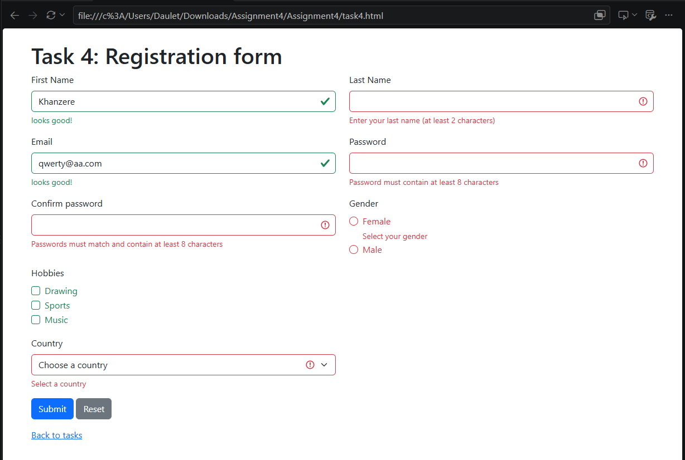

# Assignment 4: Forms and Validation

**Student Name:** Suleimen Khanzere

**Group:** IT-2504

## Objective
The goal of this assignment is to learn how to create HTML forms, use HTML5 validation, style forms with Bootstrap, and display validation feedback.

## Task 0: Simple Contact Form
Created a basic contact form with Name, Email, and Message fields and a Submit button. Each field has a label.

## Task 1: HTML5 Validation

Added HTML5 validation attributes such as `required`, `type="email"`, `minlength`, and `maxlength`. Tested the form with empty fields and invalid email addresses.

## Task 2: Bootstrap Form Styling

Recreated the contact form using Bootstrap form classes. Used Bootstrap's grid system, placeholders, and helper text to improve the layout.

## Task 3: Bootstrap Validation Styles

Added Bootstrap validation feedback classes and messages to the contact form. Used JavaScript to activate validation styles when the form is submitted. Tested the form with valid and invalid data.

## Task 4: Registration Form

Created a responsive registration form containing:

- First Name and Last Name
- Email
- Password and Confirm Password
- Gender radio buttons
- Hobbies checkboxes
- Country dropdown
- Submit and Reset buttons

Used Bootstrap Grid for the layout and HTML5 validation attributes to check the form fields. Added JavaScript to display Bootstrap validation feedback and check whether the passwords match.

## Summary

In this assignment, I learned how to create forms using HTML, validate user input with HTML5, and style forms with Bootstrap. I also learned how to use Bootstrap validation feedback and JavaScript to check form input and display error messages.

